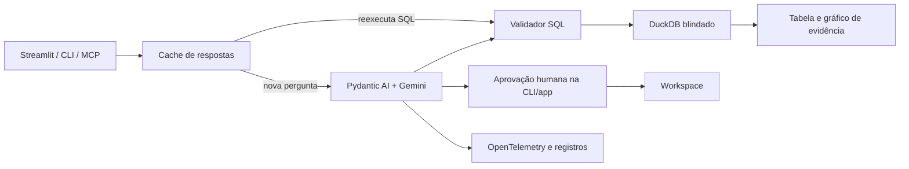

# AnalisIA

Agente de IA que transforma perguntas em português em análises verificáveis: **resposta +
SQL + tabela + visualização**. O Brasileirão Série A 2003–2024 demonstra o fluxo completo,
incluindo recusas quando os dados não permitem responder.

Projeto de portfólio de João Victor, construído em fases para estudar agentes, Dados e BI.
O núcleo pode ser usado pelo navegador, terminal ou protocolo MCP. **Importe suas bases CSV
e Parquet**, selecione a base ativa e analise outros domínios com o mesmo agente.

A interface da **AnalisIA** reúne sugestões editáveis de perguntas, evidências exportáveis,
dashboard com busca e filtros e exploração visual das colunas. Identifique a base ativa e
confira tabela, SQL e consumo em cada análise. O pacote e as integrações `olheiro-*` preservam
seus nomes técnicos; `uv run analisia` é a entrada principal do navegador.

## Capacidades

- **Perguntar:** consultas SQL, insights, gráficos e aprovação humana para salvar resultados.
- **Continuar uma análise:** contexto limitado por sessão no app e na CLI com `--chat`.
- **Dashboard:** fixa análises e reexecuta o SQL sem chamar o modelo.
- **Dados:** explora tabelas, glossário e perfis de colunas.
- **Operação:** acompanha latência, requisições, tokens, custo equivalente e traces.
- **Cache:** reexecuta a evidência das perguntas repetidas com zero requisições ao LLM.
- **MCP:** expõe SQL, perfis, contexto e perguntas ao agente em modo de leitura.
- **Bases:** importação por upload ou terminal; catálogo automático, glossário opcional e
  workspace, cache e dashboard separados por base.
- **Qualidade e semântica:** prévia de importação, ajuste de tipos e codificação, diagnóstico
  de nulos/duplicidades, verificação de relacionamentos e editor de descrições, unidades e regras.

O modelo gera a análise; os números exibidos vêm do SQL executado no DuckDB. A validação
não garante toda afirmação qualitativa do modelo: a evidência fica disponível para inspeção.

## Começar pela interface

Requisitos: **Python 3.13** e [uv](https://docs.astral.sh/uv/getting-started/installation/).
O uv usa a versão registrada em `.python-version`.

```bash
git clone https://github.com/joaovitor2410/AnalisIA.git
cd AnalisIA
uv sync --locked
cp -n .env.example .env
# Preencha GOOGLE_API_KEY no .env para fazer perguntas ao Gemini.
uv run analisia
```

Abra o endereço exibido no terminal, normalmente **http://localhost:8501**. O comando carrega
os CSVs quando o banco está ausente; valida e preserva uma base existente. Sem chave, a
interface, o explorador, o dashboard e respostas já guardadas continuam disponíveis.

| Quero usar… | Comando | Comportamento |
|---|---|---|
| Interface no navegador | `uv run analisia` | Inicia o Streamlit e mostra o endereço |
| Pergunta no terminal | `uv run olheiro-ask --verbose "Qual região tem mais títulos?"` | Mostra resposta e evidências |
| Conversa no terminal | `uv run olheiro-ask --chat` | Mantém contexto; `/nova` limpa e `/sair` encerra |
| Integração MCP | `uv run olheiro-mcp` | Aguarda um cliente por stdin/stdout, sem abrir janela |
| Testar MCP sem Gemini | `uv run python examples/mcp_client.py` | Inicia um cliente e consulta temporadas |

Também funciona `uv run streamlit run src/olheiro/app.py`.
Para conectar ao Claude, veja [docs/mcp.md](docs/mcp.md).

## Usar seus CSVs e Parquets

No modo pessoal, abra **Dados → Importar outra base**, envie arquivos e informe um nome e
identificador. Confira a prévia e os tipos antes de importar; use `VARCHAR` para preservar
códigos com zeros iniciais. A base é selecionada após a importação; a barra lateral permite trocar.
O limite padrão é 50 MB por importação. Não é preciso escrever um glossário para começar.

Exemplo com dados sintéticos de uma loja:

```bash
uv run olheiro-dataset import examples/datasets/retail \
  --name loja --title "Loja (dados sintéticos)" \
  --glossary examples/datasets/retail/glossary.toml
OLHEIRO_DATASET=data/datasets/loja/dataset.toml uv run olheiro-app
```

Pergunte: “Qual o faturamento realizado por região?”. Para seus dados, substitua a pasta
por outra pasta ou por um arquivo `.csv`/`.parquet`; `--glossary` é opcional. A configuração
`OLHEIRO_DATASET` também vale para CLI, MCP e diagnóstico. Bases pessoais ficam em
`data/datasets/`, fora do Git. Veja [o guia de bases](docs/datasets.md).

A [auditoria do projeto](docs/auditoria-2026-10-27.md) registra os achados, o estado das fases
e a sequência proposta: qualidade/semântica, avaliações em outros domínios e contexto de conversa.
A [revisão de 03/11/2026](docs/auditoria-2026-11-03.md) corrige falhas de cache, validação SQL,
avaliação da evidência e tratamento de erros, e detalha a próxima etapa F9B.
A **F9B foi implementada**: veja [qualidade e semântica dos dados](docs/qualidade.md) para usar
prévia, tipos reproduzíveis, diagnósticos e edição das regras. Catálogos grandes têm busca
seletiva para o agente e o MCP. A [revisão de 04/11/2026](docs/auditoria-2026-11-04.md)
validou essa entrega e avançou para avaliações de futebol, vendas e estoque.
Uma [nova varredura em 06/11](docs/auditoria-2026-11-06.md) corrigiu casos de quota,
leitura de traces e avaliação da evidência. O autor manteve a demo pública; as
[opções de hospedagem](docs/hospedagem.md) estão preparadas para sua escolha.
A **F9C** acrescenta [conversa com contexto](docs/conversa.md): faça uma pergunta completa
e depois continue com “e em 2020?”, sempre com evidência própria para cada análise.

## Demo para visitantes

```bash
OLHEIRO_DEMO_MODE=true uv run olheiro-app --server.port=8503
```

Abra http://localhost:8503. Seis exemplos curados reexecutam SQL sem chamar o Gemini, incluindo
o empate entre os maiores campeões e a recusa de perguntas sobre artilharia. Dashboard,
histórico e novas respostas em cache pertencem à sessão; o workspace pessoal não é aberto.
A página Operação fica fora da demo e os registros omitem o conteúdo das perguntas e erros.

Novas perguntas ao modelo exigem `OLHEIRO_DEMO_MODEL_ENABLED=true` e chave de API. Há limite
por sessão (padrão 5), por dia UTC no disco compartilhado (padrão 10 tentativas) e por análise (6 requisições
contabilizadas pelo agente). Os exemplos continuam disponíveis após os limites.
Veja [docs/demo.md](docs/demo.md). A demo está preparada para revisão local; a publicação
continua pendente da escolha de hospedagem e das condições de redistribuição dos dados.

Exemplos: “Quais times têm mais títulos desde 2003?”, “Como evoluíram os pontos dos campeões?”
e “Qual o aproveitamento dos campeões considerando os jogos de cada temporada?”. Os dados
são classificações finais; não há estatísticas individuais nem resultados de cada partida.

## Docker local

Requisito: Docker Engine/Desktop com Compose v2. O build usa `uv.lock`; `.env`, bancos locais,
cache pessoal, dashboard e logs ficam fora da imagem.

```bash
docker compose up --build --detach --wait
# Abra http://localhost:8501
docker compose logs --follow app
```

O Compose lê do `.env` a chave e as opções de modelo, se o arquivo existir. Sem chave, a
interface inicia para exploração. O volume `olheiro_state` guarda o estado separadamente dos
arquivos locais. Outra porta: `OLHEIRO_PORT=8502 docker compose up --detach --wait`.

```bash
docker compose exec -T app python deploy/smoke.py  # validação sem Gemini
docker compose down                             # preserva o volume
```

A aplicação roda sem root, com filesystem de leitura e escrita em `/state` e `/tmp`. A rede
da aplicação é interna; um proxy permite apenas túneis HTTPS para a API Gemini. A interface
é publicada em `127.0.0.1`. A receita atende ao uso local de uma instância; preparação para
visitantes e publicação online ficam para a próxima etapa.

Detalhes em [docs/deployment.md](docs/deployment.md). A infraestrutura base passou na
[CI com Docker](https://github.com/joaovitor2410/AnalisIA/actions/runs/40365502597).
A [CI da F8B](https://github.com/joaovitor2410/AnalisIA/actions/runs/40502502772) passou
nos cenários pessoal e demo. A [CI da auditoria e F9A/F9A.1](https://github.com/joaovitor2410/AnalisIA/actions/runs/41632724779)
também passou após o push de 03/11. A [CI da F9B](https://github.com/joaovitor2410/AnalisIA/actions/runs/41637039752)
passou em 03/11, incluindo qualidade e contêineres pessoal/demo. A ampliação das avaliações
de 04/11 foi enviada no commit `94f5cca` e sua
[CI passou](https://github.com/joaovitor2410/AnalisIA/actions/runs/41843227764).
A [CI da F9C](https://github.com/joaovitor2410/AnalisIA/actions/runs/41865983452) também passou
após o push de `071dd2d`. A [CI da F8C.1](https://github.com/joaovitor2410/AnalisIA/actions/runs/42211982307)
passou após o push de `0a66018`. As correções de 06/11 têm validação local e aguardam
seu próprio push/CI. Nenhum provedor foi contratado nem a demo publicada.

## Arquitetura



A defesa combina sqlglot, restrições no DuckDB e aprovação humana para gravações. Dados
brutos são anexados em leitura; consultas têm prazo de 10 segundos e retornam até 50 linhas.
Essas camadas não substituem isolamento do sistema operacional; o Compose acrescenta
isolamento de processo, restrição de escrita e controle de saída de rede.

Tecnologias: Python 3.13, Pydantic AI, Gemini, DuckDB, sqlglot, Plotly, Streamlit, OpenTelemetry,
SDK oficial MCP, pytest, Ruff, mypy, uv, Docker Compose e GitHub Actions.

## Validar e desenvolver

```bash
uv run olheiro-check
uv run pytest -q
uv run ruff check .
uv run ruff format --check .
uv run mypy
uv build
```

Os testes usam `FunctionModel`, bancos temporários e `AppTest`, sem consumir cota de API.
A [CI](.github/workflows/ci.yml) executa qualidade e build do pacote; depois constrói os
contêineres e verifica inicialização, interface e isolamento, sem chave. Ela não publica
imagens, não faz deploy e não executa avaliações pagas.

Para reconstruir a base: `uv run olheiro-load`. Esse comando recria `raw`; feche os processos
que usam o banco antes da carga. O workspace é separado. App e MCP em processos distintos
devem usar caminhos diferentes de `WORKSPACE_PATH` quando executados simultaneamente, pois
o DuckDB admite um processo escritor por arquivo.

As opções estão em [.env.example](.env.example). Traces podem ser locais, enviados por OTLP
ou desligados; o arquivo local alimenta a página Operação.

## Avaliações e limites

Há **59 casos em três suítes**: Brasileirão (39), vendas (10) e estoque (10), com **44
gabaritos SQL** e avaliadores determinísticos. Os demais casos verificam recusas e segurança.
Cada suíte materializa seus arquivos versionados em banco temporário, com workspace
descartável, sem abrir a base pessoal selecionada. Valide sem chave nem chamada ao modelo:

```bash
uv run --locked olheiro-eval --suite brasileirao --validate-only
uv run --locked olheiro-eval --suite vendas --validate-only
uv run --locked olheiro-eval --suite estoque --validate-only
```

A rodada real de **09/11/2026** executou os 59 casos em cada modelo: **118 execuções**.
Após corrigir apresentações válidas dos gabaritos, o Flash teve evidência equivalente em
**41/44 casos** e o Lite em **39/44**. Houve três/oito falhas por limite, respectivamente;
as notas não significam aprovação de todas as respostas. Veja o
[relatório da F5 e dos 328 testes](docs/f5-2026-11-09.md) e a
[lista priorizada de pendências](docs/pendencias-projeto.md).

```bash
uv run olheiro-eval --suite vendas --model google:gemini-3.8-flash
```

O comando apresenta estimativa e pede confirmação de custo. Use `--output-dir` para separar
rodadas e `--regrade` para reaplicar os avaliadores às saídas salvas sem modelo. Testes com modelo falso não
substituem a rodada real. Resultados são separados por suíte/modelo e incluem a revisão dos
arquivos usados. O [guia de avaliações](docs/avaliacoes.md) detalha casos, execução e limites.

O app e a CLI com `--chat` usam até seis análises recentes, com teto de 16.000 caracteres,
para interpretar continuações. Nova exploração, troca de base ou mudança de semântica limpam
o contexto. Perguntas prontas do app iniciam contexto novo; a CLI simples e o MCP continuam
independentes. Histórico não autoriza gravações e cada resposta exige seu próprio SQL.
O cache distingue contextos e invalida respostas quando a revisão dos dados/glossário ou a
evidência muda. Dashboard, cache e registros pertencem à base
no modo pessoal; traces da interface têm destino comum por processo. A demo usa estado por
sessão, sem persistência entre sessões.
As chaves do cache preservam sinais, acentos, maiúsculas e espaços internos: perguntas com
filtros ou códigos diferentes não compartilham respostas. Os atalhos de perguntas prontas
continuam funcionando sem modelo; a CLI também consulta o cache antes de exigir chave de API.
Logs e traces locais têm rotação por tamanho (5 MiB e três arquivos anteriores por padrão).
Cache/dashboard coordenam escritores no mesmo disco, e a quota diária da demo persiste em
arquivo. Veja [preparação operacional](docs/operacao.md) para configurar, validar e entender
o escopo local dessas garantias. Autenticação e estado entre réplicas sem disco comum continuam
pendentes da definição da hospedagem/acesso.
DuckDB permanece na linha 1.5; a migração para 2.x requer teste separado dos bancos.

## Dados e licença

Dataset: [Brazilian Football Dataset [2003 - 2024], de Lucas Yukio Imafuko](https://www.kaggle.com/datasets/lucasyukioimafuko/brasileirao-serie-a-2006-2022).
São 450 classificações e 45 cadastros de clubes. O glossário registra diferenças de pontuação,
cadastros ausentes e comparações entre temporadas com quantidades diferentes de jogos.

Código sob [MIT](LICENSE). Os dados têm condições próprias da fonte; procedência, metadados
de licença e hashes estão em [data/raw/SOURCE.md](data/raw/SOURCE.md). Publicação da demo e
distribuição de imagem com os CSVs aguardam a confirmação dessas condições.
O roteiro e as decisões técnicas estão em [CLAUDE.md](CLAUDE.md).
