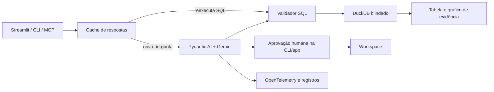

# Olheiro

Agente de IA que transforma perguntas em português em análises verificáveis: **resposta +
SQL + tabela + visualização**. O Brasileirão Série A 2003–2024 demonstra o fluxo completo,
incluindo recusas quando os dados não permitem responder.

Projeto de portfólio de João Victor, construído em fases para estudar agentes, Dados e BI.
O núcleo pode ser usado pelo navegador, terminal ou protocolo MCP.

## Capacidades

- **Perguntar:** consultas SQL, insights, gráficos e aprovação humana para salvar resultados.
- **Dashboard:** fixa análises e reexecuta o SQL sem chamar o modelo.
- **Dados:** explora tabelas, glossário e perfis de colunas.
- **Operação:** acompanha latência, requisições, tokens, custo equivalente e traces.
- **Cache:** reexecuta a evidência das perguntas repetidas com zero requisições ao LLM.
- **MCP:** expõe SQL, perfis, contexto e perguntas ao agente em modo de leitura.

O modelo gera a análise; os números exibidos vêm do SQL executado no DuckDB. A validação
não garante toda afirmação qualitativa do modelo: a evidência fica disponível para inspeção.

## Começar pela interface

Requisitos: **Python 3.13** e [uv](https://docs.astral.sh/uv/getting-started/installation/).
O uv usa a versão registrada em `.python-version`.

```bash
git clone https://github.com/joaovitor2410/AnalisIA.git
cd AnalisIA
uv sync --locked
cp -n .env.example .env
# Preencha GOOGLE_API_KEY no .env para fazer perguntas ao Gemini.
uv run olheiro-app
```

Abra o endereço exibido no terminal, normalmente **http://localhost:8501**. O comando carrega
os CSVs quando o banco está ausente; valida e preserva uma base existente. Sem chave, a
interface, o explorador, o dashboard e respostas já guardadas continuam disponíveis.

| Quero usar… | Comando | Comportamento |
|---|---|---|
| Interface no navegador | `uv run olheiro-app` | Inicia o Streamlit e mostra o endereço |
| Pergunta no terminal | `uv run olheiro-ask --verbose "Qual região tem mais títulos?"` | Mostra resposta e evidências |
| Integração MCP | `uv run olheiro-mcp` | Aguarda um cliente por stdin/stdout, sem abrir janela |
| Testar MCP sem Gemini | `uv run python examples/mcp_client.py` | Inicia um cliente e consulta temporadas |

Também funciona `uv run streamlit run src/olheiro/app.py`.
Para conectar ao Claude, veja [docs/mcp.md](docs/mcp.md).

Exemplos: “Quais times têm mais títulos desde 2003?”, “Como evoluíram os pontos dos campeões?”
e “Qual o aproveitamento dos campeões considerando os jogos de cada temporada?”. Os dados
são classificações finais; não há estatísticas individuais nem resultados de cada partida.

## Docker local

Requisito: Docker Engine/Desktop com Compose v2. O build usa `uv.lock`; `.env`, bancos locais,
cache pessoal, dashboard e logs ficam fora da imagem.

```bash
docker compose up --build --detach --wait
# Abra http://localhost:8501
docker compose logs --follow app
```

O Compose lê do `.env` a chave e as opções de modelo, se o arquivo existir. Sem chave, a
interface inicia para exploração. O volume `olheiro_state` guarda o estado separadamente dos
arquivos locais. Outra porta: `OLHEIRO_PORT=8502 docker compose up --detach --wait`.

```bash
docker compose exec -T app python deploy/smoke.py  # validação sem Gemini
docker compose down                             # preserva o volume
```

A aplicação roda sem root, com filesystem de leitura e escrita em `/state` e `/tmp`. A rede
da aplicação é interna; um proxy permite apenas túneis HTTPS para a API Gemini. A interface
é publicada em `127.0.0.1`. A receita atende ao uso local de uma instância; preparação para
visitantes e publicação online ficam para a próxima etapa.

Detalhes e validação em [docs/deployment.md](docs/deployment.md). O build e o runtime Docker
precisam ser verificados num ambiente com Docker; os testes Python não substituem essa etapa.

## Arquitetura



A defesa combina sqlglot, restrições no DuckDB e aprovação humana para gravações. Dados
brutos são anexados em leitura; consultas têm prazo de 10 segundos e retornam até 50 linhas.
Essas camadas não substituem isolamento do sistema operacional; o Compose acrescenta
isolamento de processo, restrição de escrita e controle de saída de rede.

Tecnologias: Python 3.13, Pydantic AI, Gemini, DuckDB, sqlglot, Plotly, Streamlit, OpenTelemetry,
SDK oficial MCP, pytest, Ruff, mypy, uv, Docker Compose e GitHub Actions.

## Validar e desenvolver

```bash
uv run olheiro-check
uv run pytest -q
uv run ruff check .
uv run ruff format --check .
uv run mypy
uv build
```

Os testes usam `FunctionModel`, bancos temporários e `AppTest`, sem consumir cota de API.
A [CI](.github/workflows/ci.yml) executa qualidade e build do pacote; depois constrói os
contêineres e verifica inicialização, interface e isolamento, sem chave. Ela não publica
imagens, não faz deploy e não executa avaliações pagas.

Para reconstruir a base: `uv run olheiro-load`. Esse comando recria `raw`; feche os processos
que usam o banco antes da carga. O workspace é separado. App e MCP em processos distintos
devem usar caminhos diferentes de `WORKSPACE_PATH` quando executados simultaneamente, pois
o DuckDB admite um processo escritor por arquivo.

As opções estão em [.env.example](.env.example). Traces podem ser locais, enviados por OTLP
ou desligados; o arquivo local alimenta a página Operação.

## Avaliações e limites

Há 39 casos com gabaritos SQL em sete categorias e avaliadores determinísticos. A rodada
comparativa com modelos reais aguarda ativação do faturamento pelo autor.

```bash
uv run olheiro-eval --model google:gemini-3.8-flash
```

O comando apresenta estimativa e pede confirmação de custo. Testes com modelo falso não
substituem a rodada real.

Perguntas são independentes, sem memória de conversa. O texto do cache pode ficar antigo
se os dados mudarem, embora a tabela seja reexecutada. Dashboard, cache e logs pertencem à
instância; publicação multiusuário exige isolamento adicional. Logs ainda não têm rotação.
DuckDB permanece na linha 1.5; a migração para 2.x requer teste separado dos bancos.

## Dados e licença

Dataset: [Brazilian Football Dataset [2003 - 2024], de Lucas Yukio Imafuko](https://www.kaggle.com/datasets/lucasyukioimafuko/brasileirao-serie-a-2006-2022).
São 450 classificações e 45 cadastros de clubes. O glossário registra diferenças de pontuação,
cadastros ausentes e comparações entre temporadas com quantidades diferentes de jogos.

Código sob [MIT](LICENSE). Os dados têm condições próprias da fonte; procedência, metadados
de licença e hashes estão em [data/raw/SOURCE.md](data/raw/SOURCE.md). Publicação da demo e
distribuição de imagem com os CSVs aguardam a confirmação dessas condições.
O roteiro e as decisões técnicas estão em [CLAUDE.md](CLAUDE.md).
